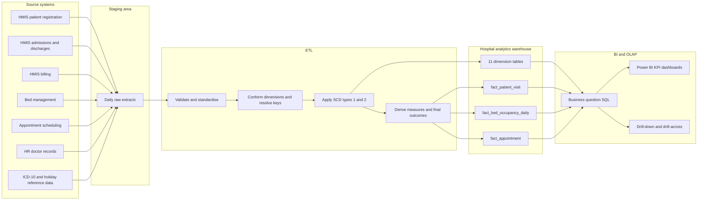
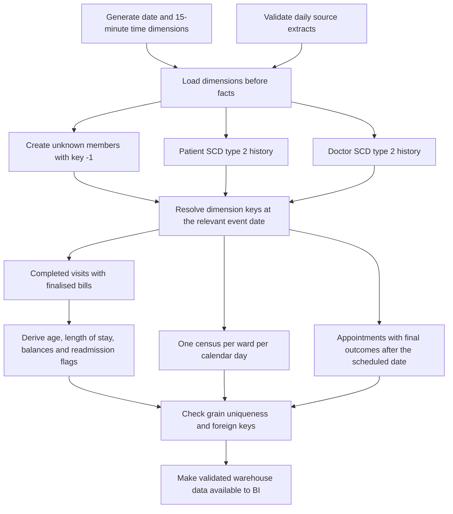

# Warehouse architecture

These Mermaid diagrams describe the proposed design for the project proposal and business requirements. Loads run daily (T+1).

## Data flow

## Load dependencies

Patient versions are selected at admission for visits and at the scheduled appointment date for appointments. Doctor versions follow the responsible doctor at discharge for visits and the scheduled date for appointments. Unknown keys are used when a dimension lookup cannot be resolved.

Date, Patient, Doctor and Department are conformed dimensions. Compare business processes by aggregating each fact table to the required shared dimension level before joining results.
